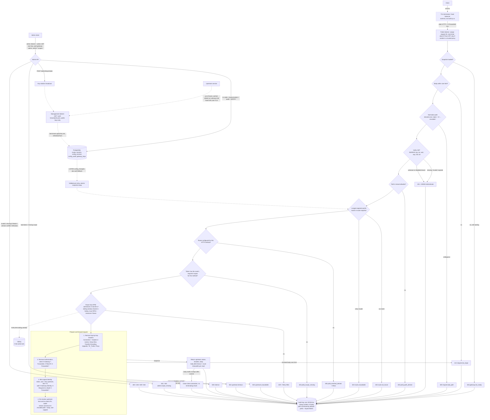

# Architecture: request flow

Rejected requests never reach the upstream. The audit entry is written for every outcome.

The request path reads only the in-memory snapshot and never queries the database, so a DB outage doesn't stop traffic. Admin writes go to PostgreSQL and reach every instance via `NOTIFY`, with a poll as fallback. See [multi-instance.md](multi-instance.md).
